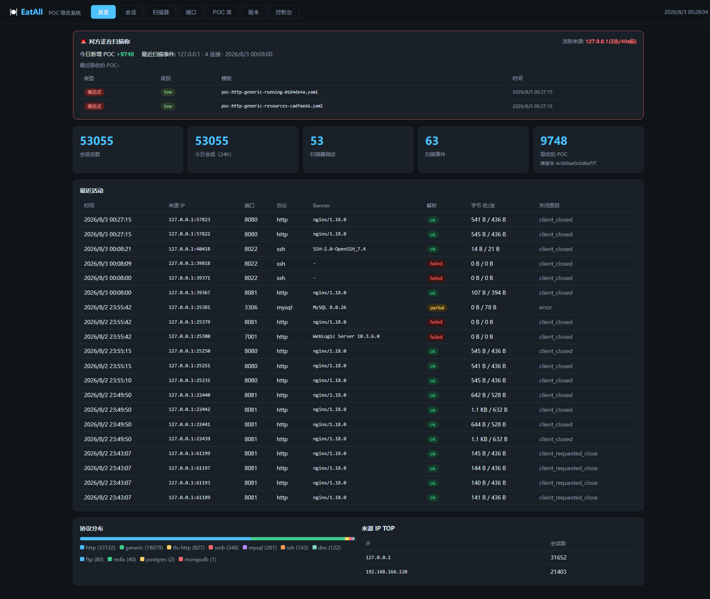
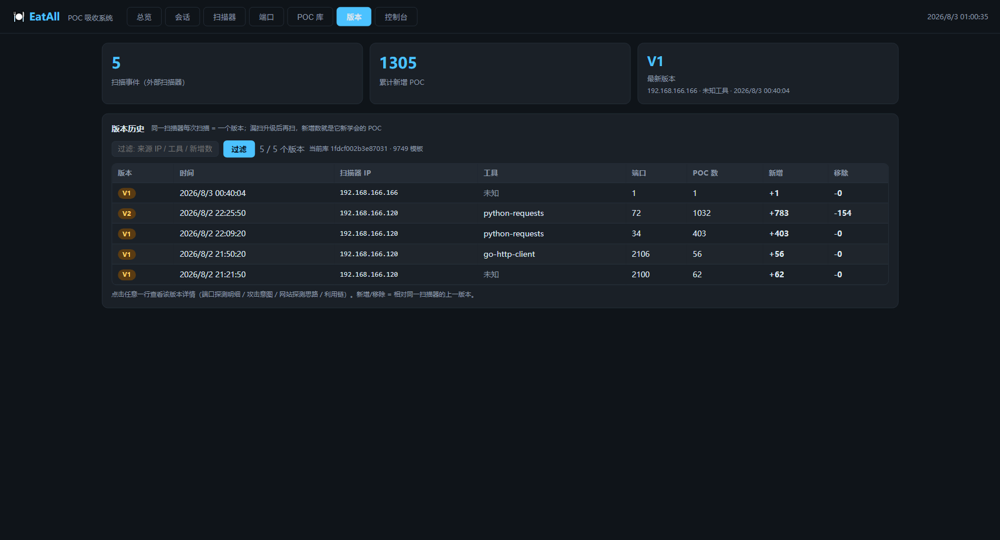
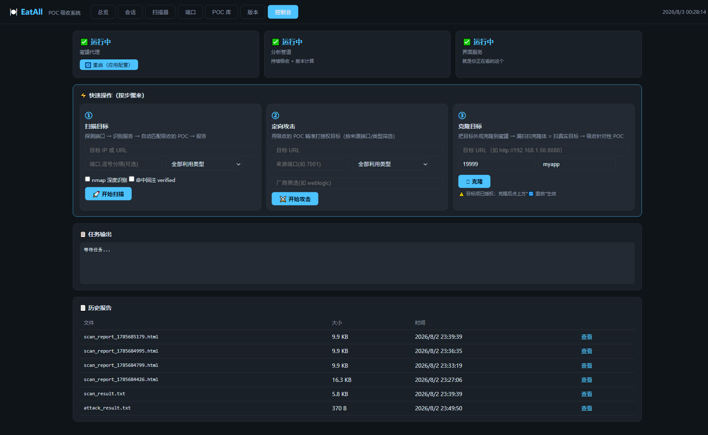
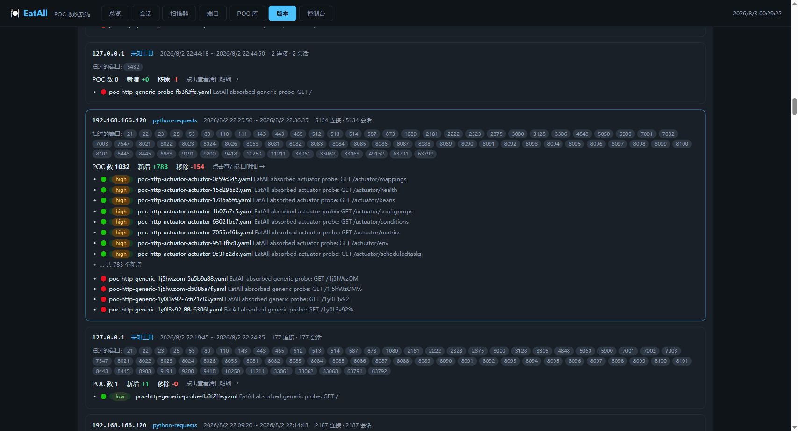
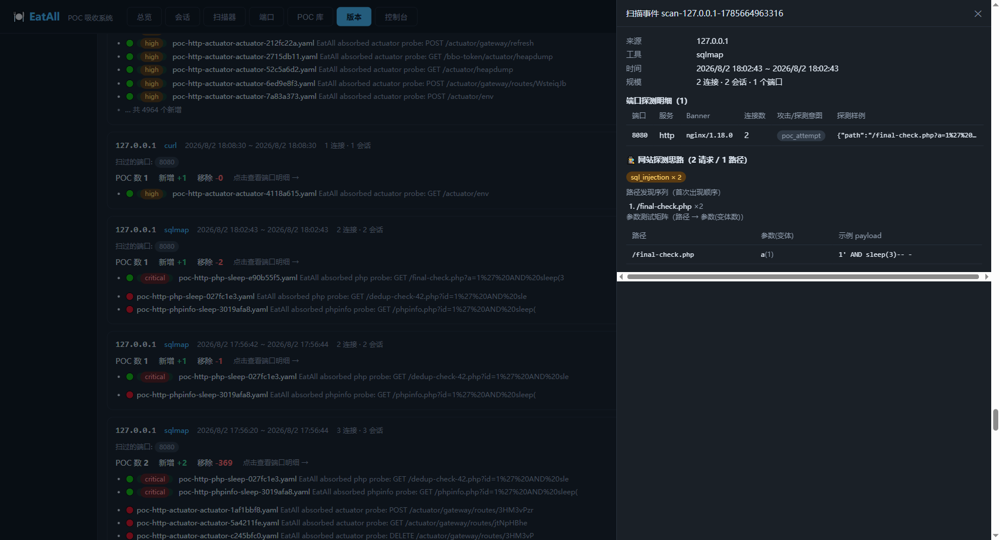

# EatAll 使用手册

POC 吸收系统：把蜜罐丢给漏扫扫，自动捕获对方探测/攻击流量，解析识别扫描器指纹，
重建为可复用的 POC 模板，并追踪扫描器升级（版本对比）。

```
扫描器/攻击者 ──> 蜜罐(Go 代理, 多协议 banner 伪装)
                      │ JSONL 会话记录 (data/sessions/)
                      ▼
               Python 分析管道 ──> out/templates/poc-*.yaml ──> nuclei -t
                      │
                      ▼
               dashboard (http://<IP>:9090) 7 页签看结果
```

---

## 1. 系统组成（三件套）

| 组件 | 命令 | 作用 |
|---|---|---|
| ① 蜜罐代理 | `bin\eatal-proxy.exe -config <配置>` | 监听端口，伪装服务，捕获攻击流量 |
| ② 分析管道 | `python pipeline\main.py run` | 入库 → 指纹 → POC 重建 → 版本计算 |
| ③ 展示界面 | `python pipeline\main.py dashboard` | http://<IP>:9090 看结果（默认 0.0.0.0，局域网可访问） |

三者独立进程；②③依赖①的产物（`data/sessions/`），重启任意一个不影响其他。

**管道子命令**（`python pipeline\main.py`）：

| 子命令 | 作用 |
|---|---|
| `run`（默认） | 长驻：ingest 2s 轮询 + 每轮 build + 周期扫描事件计算，崩溃断点续传 |
| `ingest` | 仅轮询入库（`--once` 单次） |
| `fingerprint` | ingest 一次 + 关闭 idle 流 → 扫描器指纹表 |
| `build` | ingest 一次 + 关闭全部流 + 全量重建模板（`--validate` 逐模板跑 nuclei 校验，慢，仅单次构建用） |
| `scan` | 扫描事件检测 + 相邻 diff + 库快照（版本控制） |
| `dashboard` | 展示界面（`--port` 改端口） |

## 2. 快速开始

```powershell
cd E:\EatAll

# 构建 + 证书
make build cert          # 或手动: go build -o bin/eatal-proxy ./cmd/proxy

# 开发运行（高位端口，Windows 免管理员）
make dev                 # = bin\eatal-proxy.exe -config config\config.dev.yaml

# 测试
make test                # Go 单测
python -m pytest tests\py -q --basetemp=.pytest_tmp

# 冒烟验证
curl -i http://127.0.0.1:8081/struts2-showcase/index.action
nmap -sV -p 8022,8081,8443,8445,33061 127.0.0.1
```

## 3. 完整启动流程（Windows 演示示例）

```powershell
# ① 起蜜罐（宽端口模式：1-1000 + 7000-7100 + 8000-9000 + 服务端口）
.\bin\eatal-proxy.exe -config config\config.broad.yaml

# ② 起管道（自动吸收 + 版本计算，长驻）
python pipeline\main.py run

# ③ 起展示界面
python pipeline\main.py dashboard        # 默认 0.0.0.0:9090
```

查看：浏览器打开 `http://<本机IP>:9090`（本机看用 http://127.0.0.1:9090）。

## 4. 三种部署形态

| 形态 | 蜜罐配置 | 漏扫目标 IP | 说明 |
|---|---|---|---|
| 本机验证 | config.dev.yaml | 127.0.0.1 | 仅验证流程 |
| 局域网演示 | **config.broad.yaml**（推荐） | ipconfig 查本机 IPv4 | 漏扫从另一台机器扫 |
| 生产 VPS | config.full.yaml（Linux） | VPS 公网 IP | 全端口；`ulimit -n 70000` |

配置三档：
- `config.dev.yaml`：服务端口（8081 http / 8022 ssh / 33061 mysql / 63791 redis / 8021 ftp / 8445 smb / 8053 dns / 8443 tls / 7000-7100）
- `config.broad.yaml`：1-1000 + 7000-7100 + 8000-9000 + 服务端口 ≈2100 端口（Windows 上限，约 70MB 内存）
- `config.full.yaml`：1-65535 全端口（**仅 Linux**；Windows 上 6.5 万 socket 耗尽系统缓冲区）

`config/banners.yaml`：banner 伪装 + 伪漏洞路径（struts2 / thinkphp / weblogic / actuator / solr 等），
让扫描器把 POC 打全（nmap -sV 可识别出自洽的伪造服务）。

## 5. 让漏扫来扫

1. **漏扫扫的 IP = 运行本系统机器的 IP**（本机=127.0.0.1 / 局域网=ipconfig / VPS=公网 IP）
2. **端口可见性**：漏扫只对判定"开放"的端口做服务识别和 POC 攻击。
   蜜罐监听哪些端口，对方才探测哪些端口——想拿全量 POC 用 broad/full 配置。
   closed 端口的 SYN 探测应用层不可见
3. **防火墙放行**：
   - Windows：`netsh advfirewall firewall add rule name=eatal dir=in action=allow protocol=TCP localport=1-1000,7000-7100,8000-9000,33061,63791,8445,8053`
   - 云服务器：安全组放行对应端口
4. 对方开始扫后，**2 秒内** dashboard 总览页出现会话；扫描结束后 **~2 分钟**版本页出现扫描事件

## 6. 界面（七个页签）

| 页签 | 看什么 |
|---|---|
| 总览 | 实时吸收面板（🚨 正在被扫提示 + 最近吸收 POC）+ 统计卡片（会话/指纹/事件/POC/库版本）+ 最近活动流 + 协议分布 + 来源 TOP |
| 会话 | 分页过滤（来源 IP/协议），点开看完整解析字段 + 原始字节 hex/ascii + 攻击意图 |
| 扫描器 | 指纹（工具/置信度/扫过的端口/行为特征） |
| 端口 | 端口矩阵：每个端口被探测情况（协议/banner/次数/最近时间）→ 点开看探测明细 + 关联 POC |
| POC 库 | 吸收的全部模板（搜索/级别/利用类型过滤），点开看 YAML |
| 版本 | ① 扫描事件列表：每个事件"扫过的端口" + 攻击分类 + 新增/移除 POC；② 全局库版本线（hash 变化即库更新） |
| 控制台 | 三件套运行状态（可一键重启）+ 扫描/定向攻击/克隆三步快速操作 + 任务输出 + 历史报告 |

### 6.1 界面速览

| 截图 | 说明 |
|---|---|
|  | 总览：实时吸收面板 + 统计卡片 + 最近活动流 + 协议分布 + 来源 TOP |
|  | 版本：扫描事件列表（端口清单 + 攻击分类 + 新增/移除 POC 对比）+ 全局库版本线 |
|  | 控制台：三件套运行状态 + 扫描/定向攻击/克隆三步快速操作 + 历史报告 |
|  | 扫描事件详情：端口探测明细（攻击/探测意图分类）+ 非 HTTP POC + 利用链 |
|  | 扫描事件详情：网站漏扫（URL 爬取型）的探测思路归纳——路径序列/参数矩阵/手法统计 |

### 6.2 控制台快速操作

控制台三步操作均写入任务输出（实时滚动），可在历史报告里回看：

1. **扫描目标**：`🚀 开始扫描` → 对目标 IP/URL 端口探测 → 服务识别 → 自动匹配吸收的 POC → 报告
   （可选 nmap 深度识别、命中回注 verified）
2. **定向攻击**：`⚔️ 开始攻击` → 用吸收的 POC 精准打授权目标（按来源端口/利用类型/厂商筛选）
3. **克隆目标**：`🪞 克隆` → 把目标外观克隆到蜜罐 → 漏扫扫克隆体 = 扫真实目标 → 吸收针对性 POC
   （目标须已授权；克隆后点"🔄 重启"生效）

## 7. 版本控制（扫描器升级检测）

**版本语义：同一扫描器每次扫描 = 一个版本**（版本页按扫描器独立编号 V1、V2…）。

- 首次扫描：吸收 100 个 POC = V1；漏扫升级后再扫：命中 120 个、其中 20 个新面孔 = V2，
  **新增数就是它新学会的 POC**——这才是"版本更新"
- 每次新闭合扫描记录一条版本快照（关联 scan_id/来源/工具）；无新扫描不落快照，
  不会因库持续吸收而刷版本线
- 版本页 = 版本历史表（版本/时间/扫描器/端口/POC 数/新增/移除），点击行看详情
  （端口探测明细 / 攻击意图 / 网站探测思路 / 利用链）
- 扫描事件按"空闲间隔 > 120s"分割（`EATALL_EPISODE_GAP_SEC` 环境变量可调，慢扫描器调大）
- 手动触发计算：`python pipeline\main.py scan`
- 注意：请求内容变化的 POC 会表现为"新增+移除"（模板 id 含请求哈希）

## 8. 网站漏扫（URL 扫描）的探测思路捕获

针对 URL 的网站漏扫（AWVS/Xray/nuclei/sqlmap 爬虫式）不走端口探测路径，直接对 URL 爬取/测试。
系统通过**动态响应诱饵**让漏扫把探测思路打全，并在事件详情里**归纳展示**：

**诱饵机制（Go 代理自动注入）**：
- **链接图谱**：首页/伪路径响应自动嵌入互链链接（banners.yaml `link_pool`，首页 12 个、其他路径 4 个）→ 爬虫跟随发现深层路径
- **参数反射**：query 参数值原样回显 → XSS 反射检测器发现反射点，诱出 payload 变体
- **表单诱饵**：`form: true` 的路径（login.php/admin 等）自动追加登录表单 → 捕获 POST 参数组合

**探测思路归纳（事件详情"🕵️ 网站探测思路"区段）**：
- 路径发现序列（先扫什么后扫什么 + 每路径请求数）
- 参数测试矩阵（路径 → 参数 → 变体数 → 示例 payload）
- 手法统计 badge：sqli / xss / traversal / cmd_injection / ssti / deserialization / ssrf / lfi
- 字典爆破特征标记（60s 窗口内 >30 不同路径）

**利用链（行为层，事件详情"🔗 利用链"区段）**：
upload_exec 上传-执行链 / upload_only 上传尝试 / brute 认证爆破 / probe_exploit 先探后打 /
repeated_attack 重复确认攻击 / app_cluster_attack 应用级攻击簇。

## 9. 服务管理与运维

```powershell
# 一键重启全部 / 单独重启
powershell -ExecutionPolicy Bypass -File scripts\restart-services.ps1   # 三件套全重启（代码更新后）
powershell -ExecutionPolicy Bypass -File scripts\restart-pipeline.ps1   # 仅管道
powershell -ExecutionPolicy Bypass -File scripts\restart-dashboard.ps1  # 仅界面

# 状态检查 / 蜜罐重启（改配置后生效）
powershell -ExecutionPolicy Bypass -File scripts\service-check.ps1      # 输出 proxy=...;pipeline=...;dashboard=...
powershell -ExecutionPolicy Bypass -File scripts\service-restart.ps1    # 重启 eatal-proxy（应用 broad 配置）
```

**环境变量**：

| 变量 | 默认 | 作用 |
|---|---|---|
| `EATALL_HOME` | 仓库根目录 | 数据目录根（测试用） |
| `EATALL_EPISODE_GAP_SEC` | 120 | 扫描事件分割空闲间隔 |
| `EATALL_IGNORE_LOOPBACK` | 0 | 设 1 = 回环流量（127.0.0.1）跳过入库——生产部署（漏扫在独立 IP）建议开，避免本机验证噪音污染统计；默认关保留本机测试通道 |
| `NUCLEI_BIN` | nuclei | nuclei 可执行文件路径（模板校验用） |

**数据目录**：
- `data/sessions/*.jsonl` — 会话原始记录（单会话上限 1MB/方向）
- `data/logs/pipeline.log` — 管道日志；`data/logs/ingest_errors.log` — 入库错误
- `out/templates/poc-*.yaml` — 吸收重建的 nuclei 模板

## 10. 注意事项

- **端口冲突**：本机其他服务占用的端口（如 8080）会抢走 IPv4 连接——蜜罐配置里避开（dev/broad 已把 http 放 8081）
- **探活噪音**：同路径高频重复的 HTTP 流量（health check / 前端轮询）自动剔除，不参与事件分割；
  非 HTTP 重复连接视为爆破攻击信号不剔除
- **全端口模式**：Windows 不可行（WinError 10055），仅 Linux
- **非 HTTP POC**：tcp/network/dns 模板是"客户端首块字节回放"级（原始字节），弱于 HTTP 的精细重建；
  界面已标注
- **数据膨胀**：扫描高峰期 data/sessions 增长快，注意磁盘
- **合规**：捕获自有资产入站流量（等同蜜罐），属防御性监控；吸收的 POC 仅用于授权范围内测试。
  商业扫描器插件库的提取/传播违反 EULA，请勿扩散
